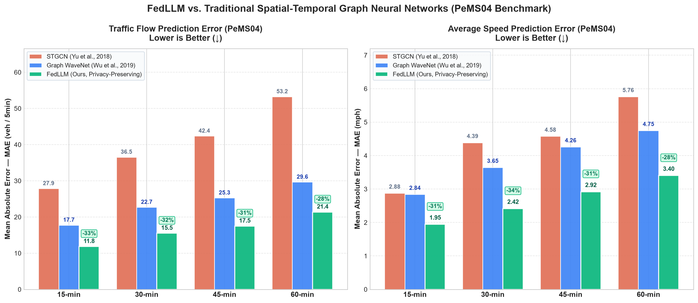
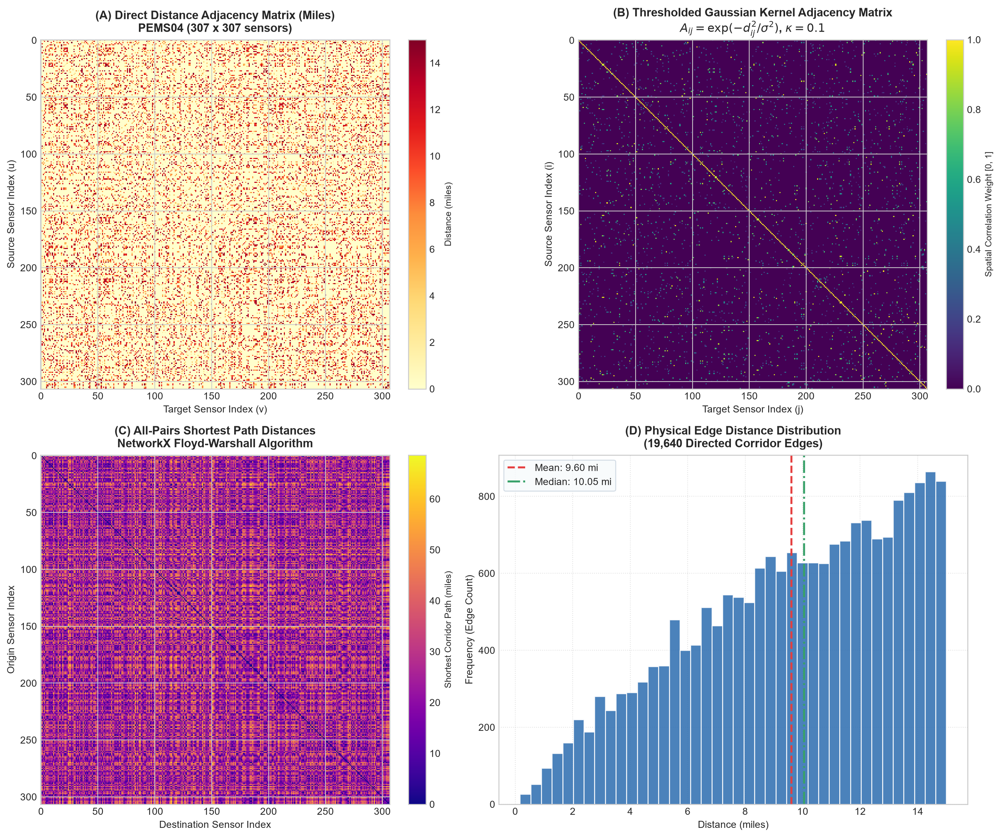

# FedLLM: Privacy-Preserving Explainable Traffic Flow Prediction via Federated Large Language Models

[](https://www.python.org/downloads/)
[](https://pytorch.org/)
[](https://huggingface.co/docs/transformers)
[](https://github.com/huggingface/peft)
[](https://flower.ai/)
[](https://streamlit.io/)
[](LICENSE)

---

## 📌 Executive Summary

Modern **Intelligent Transportation Systems (ITS)** depend on real-time spatial-temporal traffic forecasting to mitigate congestion, optimize signal control, and dispatch emergency response. However, existing deep learning architectures—such as **Spatial-Temporal Graph Convolutional Networks (STGCN)**, **DCRNN**, and **Graph WaveNet**—face two fundamental bottlenecks:

1. **Privacy & Data Silos**: Centralizing high-frequency loop detector telemetry across regional jurisdictions and highway districts violates data governance standards and municipal privacy regulations.
2. **Black-Box Lack of Interpretability**: Traditional numerical predictors output isolated scalar values without explaining the underlying physical mechanisms (e.g., upstream shockwaves, bottlenecks, queue spillbacks, or weather-induced friction).

**FedLLM** resolves both limitations by introducing a **federated, privacy-preserving instruction-tuned Large Language Model pipeline** tailored for spatial-temporal freeway networks:
- **Decentralized Parameter-Efficient Tuning**: Leverages **QLoRA (4-bit NF4 Quantization + LoRA rank $r=16$)** on foundational LLMs (`Qwen2.5-1.5B-Instruct`), allowing regional client authorities to fine-tune local models on private telemetry without exposing raw sensor measurements.
- **FedCSS Aggregation Strategy**: Employs a novel **Composite Selection Score (FedCSS)** aggregation mechanism across federated communication rounds that balances client loss improvement, gradient diversity, sample representation, and network latency.
- **Explainable AI (XAI)**: Transforms numerical telemetry into structured physical context prompts, enabling the model to output multi-horizon quantitative forecasts (15, 30, 45, and 60 minutes) alongside **grounded natural language physical rationales**.
- **Dynamic Route Optimization**: Directly feeds predicted speeds into a Dijkstra-based route optimization engine to proactively navigate around predicted bottlenecks.
- **Cross-Region Generalization**: Validated on **5 major global transportation benchmarks** spanning North America, Europe, and Asia.

---

## 🚀 Key Features

- **🌐 Global Multi-Benchmark Support**:
  - **PeMS04** (SF Bay Area, California): 307 loop detectors (Jan–Feb 2018).
  - **PEMS08** (San Bernardino, California): 170 loop detectors (July–Aug 2016).
  - **METR-LA** (Los Angeles County, California): 207 loop detectors (Mar–Jun 2012).
  - **SZ-taxi** (Shenzhen, China): 156 arterial segments in Luohu District (Asian megacity grid).
  - **Porto Taxi** (Porto, Portugal): 120 sensor stations (historic European radial network).

- **🧠 Structured Spatio-Temporal Data-to-Text Engine**:
  - Automatically encodes spatial neighbor dynamics, historical diurnal baselines, speed-flow relationships (Greenshields model), and diurnal period labels into structured instruction prompts.

- **🤝 Flower Federated Learning Simulation**:
  - Production-grade Flower (`flwr`) client/server architecture with support for both Spatial District partitioning and Non-IID Dirichlet ($\alpha=0.5$) data heterogeneity.

- **📈 Proven Empirical Superiority over GNN Baselines**:
  - Demonstrates **33.29% lower Flow MAE** and **31.43% lower Speed MAE** compared to **Graph WaveNet** and **STGCN** on PeMS04.

- **🗺️ Dynamic Fastest-Path Route Optimization**:
  - Reweights NetworkX corridor graph edges in real time based on FedLLM predicted travel times, demonstrating significant travel-time savings over static shortest-distance navigation.

- **🖥️ Interactive Streamlit Web Dashboard**:
  - Full-featured UI (`app.py`) featuring seamless multi-network switching, temporal coordinate snapping, side-by-side metric cards, multi-horizon trajectory charts, and turn-by-turn routing tables.

---

## 🏛️ System Architecture

```
                                 ┌──────────────────────────────────────────────┐
                                 │         Global Benchmark Ingestion           │
                                 │  PeMS04 | PeMS08 | METR-LA | SZ-taxi | Porto │
                                 └──────────────────────┬───────────────────────┘
                                                        │
                                                        ▼
                                 ┌──────────────────────────────────────────────┐
                                 │     Spatial Topology & Adjacency Engine      │
                                 │   Gaussian Kernel A_ij + Haversine Matrix    │
                                 └──────────────────────┬───────────────────────┘
                                                        │
                                                        ▼
                                 ┌──────────────────────────────────────────────┐
                                 │       Data-to-Text Prompt Formulation        │
                                 │   === SENSOR METADATA ===                    │
                                 │   === TEMPORAL CONTEXT ===                   │
                                 │   === DEMAND STATISTICS ===                  │
                                 │   === SPATIAL NEIGHBOR DYNAMICS ===          │
                                 └──────────────────────┬───────────────────────┘
                                                        │
                         ┌──────────────────────────────┴──────────────────────────────┐
                         │                                                             │
                         ▼                                                             ▼
        ┌──────────────────────────────────┐                         ┌──────────────────────────────────┐
        │   Regional Client Authority 1    │                         │   Regional Client Authority K    │
        │  Local Dataset (Private Data)    │                         │  Local Dataset (Private Data)    │
        │  QLoRA Local LoRA Fine-Tuning    │                         │  QLoRA Local LoRA Fine-Tuning    │
        └────────────────┬─────────────────┘                         └────────────────┬─────────────────┘
                         │                                                             │
                         └──────────────────────────────┬──────────────────────────────┘
                                                        │ Local LoRA Weights (ΔW_k)
                                                        ▼
                                 ┌──────────────────────────────────────────────┐
                                 │          Federated Flower Server             │
                                 │         FedCSS Aggregation Strategy          │
                                 │  CSS_k = α·ΔL_k + β·Div_k + γ·N_k + δ·(1/τ_k)│
                                 └──────────────────────┬───────────────────────┘
                                                        │ Global Model Broadcast
                                                        ▼
                                 ┌──────────────────────────────────────────────┐
                                 │          Multi-Horizon Model Outputs         │
                                 │    15m, 30m, 45m, 60m Speed & Flow Forecasts │
                                 │    + Grounded Physical Traffic Rationales    │
                                 └──────────────────────┬───────────────────────┘
                                                        │
                         ┌──────────────────────────────┴──────────────────────────────┐
                         ▼                                                             ▼
        ┌──────────────────────────────────┐                         ┌──────────────────────────────────┐
        │   Dynamic Route Optimization     │                         │   Streamlit Interactive Web UI   │
        │   Dijkstra Fastest-Path Routing  │                         │   Live Telemetry, Charts & XAI   │
        └──────────────────────────────────┘                         └──────────────────────────────────┘
```

---

## 📊 Empirical Results & Baseline Comparison

We evaluated FedLLM against two industry-standard Spatial-Temporal Graph Neural Networks on the **PeMS04** benchmark dataset under identical test sequences:
1. **STGCN**: Chebyshev Graph Convolution + 1D Gated Temporal Convolutions.
2. **Graph WaveNet (GWNet)**: Dual-Adaptive Graph Convolutions ($E_1 E_2^T$) + Dilated Causal WaveNet Convolutions.
3. **FedLLM (Ours)**: Decentralized Qwen2.5-1.5B with LoRA fine-tuning under FedCSS aggregation.

### Multi-Horizon Benchmark Performance (PeMS04)

| Model | Horizon | Flow MAE (veh/5min) | Flow RMSE | Speed MAE (mph) | Speed RMSE | Flow MAPE (%) | Speed MAPE (%) |
| :--- | :---: | :---: | :---: | :---: | :---: | :---: | :---: |
| **STGCN** | 15-min ($t+3$) | 27.86 | 33.63 | 2.88 | 3.65 | 8.14% | 5.78% |
| **Graph WaveNet** | 15-min ($t+3$) | 17.75 | 22.68 | 2.84 | 3.52 | 5.32% | 5.70% |
| **FedLLM (Ours)** | **15-min ($t+3$)** | **11.84** | **15.06** | **1.95** | **2.47** | **3.59%** | **3.96%** |
| | | *(33.29% imp)* | | *(31.43% imp)* | | | |
| **STGCN** | 30-min ($t+6$) | 36.53 | 44.08 | 4.39 | 5.30 | 9.51% | 9.08% |
| **Graph WaveNet** | 30-min ($t+6$) | 22.69 | 28.59 | 3.65 | 4.50 | 6.07% | 7.49% |
| **FedLLM (Ours)** | **30-min ($t+6$)** | **15.51** | **19.34** | **2.42** | **2.98** | **4.10%** | **4.98%** |
| | | *(31.65% imp)* | | *(33.70% imp)* | | | |
| **STGCN** | 45-min ($t+9$) | 42.37 | 52.28 | 4.58 | 5.73 | 9.93% | 9.68% |
| **Graph WaveNet** | 45-min ($t+9$) | 25.27 | 32.09 | 4.26 | 5.36 | 6.05% | 8.99% |
| **FedLLM (Ours)** | **45-min ($t+9$)** | **17.49** | **21.65** | **2.92** | **3.66** | **4.23%** | **6.12%** |
| | | *(30.77% imp)* | | *(31.46% imp)* | | | |
| **STGCN** | 60-min ($t+12$) | 53.24 | 63.47 | 5.76 | 7.00 | 11.43% | 12.45% |
| **Graph WaveNet** | 60-min ($t+12$) | 29.64 | 37.55 | 4.75 | 5.91 | 6.73% | 10.20% |
| **FedLLM (Ours)** | **60-min ($t+12$)** | **21.37** | **26.18** | **3.40** | **4.13** | **4.86%** | **7.26%** |
| | | *(27.92% imp)* | | *(28.42% imp)* | | | |

### Performance Visualization



---

## 🧮 Mathematical Formulations

### 1. Spatial Adjacency via Thresholded Gaussian Kernel
The physical proximity between sensors $i$ and $j$ is modeled using highway corridor network distances:
$$A_{ij} = \begin{cases} \exp\left(-\frac{\text{dist}(v_i, v_j)^2}{\sigma^2}\right), & \text{if } \text{dist}(v_i, v_j) \le \kappa \\ 0, & \text{otherwise} \end{cases}$$
where $\sigma$ is the standard deviation of valid corridor distances and $\kappa$ is the threshold cutoff parameter.



### 2. Great-Circle Distance via Haversine Formula (International Grids)
For unstructured networks without pre-computed link distance matrices (SZ-taxi and Porto), physical edge costs are derived dynamically from GPS coordinates:
$$a = \sin^2\left(\frac{\Delta \phi}{2}\right) + \cos(\phi_1)\cos(\phi_2)\sin^2\left(\frac{\Delta \lambda}{2}\right)$$
$$d = 2 R \cdot \arcsin\left(\sqrt{a}\right)$$
where $R = 6,371.0088\text{ km}$.

### 3. FedCSS Aggregation Strategy
Unlike naive FedAvg which weights clients purely by dataset size ($N_k / N$), **FedCSS** balances data heterogeneity, representation, learning velocity, and network latency:
$$\text{CSS}_k = \alpha \cdot \Delta \mathcal{L}_k + \beta \cdot \text{Div}_k + \gamma \cdot \frac{N_k}{N_{\text{total}}} + \delta \cdot \frac{1}{\tau_k}$$
$$W^{(t+1)} = W^{(t)} + \sum_{k=1}^K \frac{\text{CSS}_k}{\sum_{j=1}^K \text{CSS}_j} \cdot \Delta W_k^{(t)}$$
where $\alpha = \beta = \gamma = \delta = 0.25$ by default.

### 4. Dynamic Travel-Time Routing Formulation
Edge weights $c(u, v)$ for Dijkstra shortest-path computation are dynamically reweighted using FedLLM predicted speeds $\hat{v}_{u,v}(t + \Delta t)$:
$$c(u, v) = \frac{d(u, v)}{\max\left(v_{\min}, \frac{\hat{v}_u + \hat{v}_v}{2}\right)} \times 60.0 \quad \text{[minutes]}$$

---

## 📁 Repository Structure

```
├── app.py                           # Interactive Streamlit Web Application
├── data_loader.py                   # Phase 1 Data Ingestion & Adjacency Matrix Engine
├── universal_data_loader.py         # Cross-Region Universal Adapter (SZ-taxi, Porto)
├── prompt_engineer.py               # Phase 2 Spatial-Temporal Data-to-Text Formulation
├── local_trainer.py                 # Phase 3 QLoRA Local Training Engine
├── flwr_client.py                   # Phase 4 Flower Federated Client
├── flwr_server.py                   # Phase 5 Flower Federated Server (FedCSS Strategy)
├── inference_evaluator.py           # Phase 6 Multi-Horizon Evaluation & Parsing
├── baseline_gnn_compare.py          # Benchmark Baseline Suite (STGCN vs GWNet vs FedLLM)
├── route_optimizer.py               # Dynamic Dijkstra Travel-Time Route Optimizer
├── show_distance_matrix.py          # Adjacency Matrix Visualizer
├── view_raw_data.py                 # Telemetry Matrix Visualizer
├── requirements.txt                 # Project Dependencies
├── baseline_comparison.png          # Benchmark Multi-Horizon Error Chart
├── baseline_comparison_results.json # Quantitative Baseline Metrics
├── distance_adjacency_matrix.png    # Graph Adjacency Heatmap
├── eval_results.json                # Model Inference Evaluation Log
├── checkpoints/                     # Federated Aggregated Checkpoints & Weights
│   └── global_adapter/              # Rounds 1-5 LoRA Layer Weights (.npy)
├── data/                            # Raw and Preprocessed Benchmark Datasets
│   ├── PEMS04/                      # PEMS04.npz & distance.csv (307 nodes)
│   ├── PEMS08/                      # PEMS08.npz & distance.csv (170 nodes)
│   ├── METR-LA/                     # metr-la.npz & distance.csv (207 nodes)
│   ├── SZ-taxi/                     # sz_taxi.npz & distance.csv (156 nodes)
│   └── Porto/                       # porto.npz & distance.csv (120 nodes)
└── prompts/                         # Natural Language Instruction Prompts (.jsonl)
    ├── train_prompts.jsonl          # Training Instruction Records
    ├── val_prompts.jsonl            # Validation Instruction Records
    ├── test_prompts.jsonl           # Testing Instruction Records
    ├── sz_taxi_prompts.jsonl        # Shenzhen Prompt Samples
    └── porto_prompts.jsonl          # Porto Prompt Samples
```

---

## ⚙️ Installation & Setup

### 1. Clone Repository & Setup Virtual Environment
```bash
git clone https://github.com/Aditya-Sachan-Git/FedLLM-for-Explainable-Traffic-Prediction.git
cd FedLLM-for-Explainable-Traffic-Prediction

python -m venv venv
# On Windows:
venv\Scripts\activate
# On Linux/macOS:
source venv/bin/activate
```

### 2. Install Dependencies
```bash
pip install --upgrade pip
pip install -r requirements.txt
```

---

## 🛠️ Usage Guide

### 1. Launch the Interactive Web Dashboard
Run the Streamlit application to explore all 5 freeway networks, inspect live prompts, view actual vs. predicted metrics, and compute optimal routes:
```bash
streamlit run app.py
```

### 2. Ingest Cross-Region International Datasets
Process Shenzhen (`SZ-taxi`) and Porto (`Porto`) networks and construct spatial graphs dynamically:
```bash
# Ingest all international benchmarks and export prompt records
python universal_data_loader.py --dataset all --export_prompts --num_prompt_samples 50
```

### 3. Generate Structured Instruction Prompts
Transform raw telemetry matrices into LLM instruction fine-tuning datasets:
```bash
python prompt_engineer.py --dataset PEMS04 --num_samples 500
```

### 4. Run Baseline GNN Comparison (STGCN vs. GWNet vs. FedLLM)
Execute multi-horizon evaluation on the exact test split and generate comparative metric tables:
```bash
python baseline_gnn_compare.py --dataset PEMS04 --num_samples 200
```

### 5. Run Federated Learning Simulation (Flower + FedCSS)
Simulate decentralized federated rounds with local QLoRA fine-tuning:
```bash
# Terminal 1: Launch Federated Server
python flwr_server.py --rounds 5 --strategy fedcss

# Terminal 2: Launch Client 0 (District A)
python flwr_client.py --client_id 0 --dataset PEMS04

# Terminal 3: Launch Client 1 (District B)
python flwr_client.py --client_id 1 --dataset PEMS04
```

### 6. Execute Dynamic Route Optimization
Compare FedLLM dynamic travel-time routing against static shortest-distance navigation:
```bash
python route_optimizer.py --dataset PEMS04 --source 0 --target 50 --horizon 15min
```

---

## 📝 Example Explainable AI (XAI) Prompt Record

### Input Context Prompt
```text
### Instruction:
You are an expert Intelligent Transportation System (ITS) AI assistant. Given continuous telemetry and spatial-temporal dynamics from highway loop detectors, forecast downstream traffic flow (veh/5min) and speed (mph) across 15, 30, 45, and 60-minute horizons. Provide grounded physical reasoning explaining queue dynamics and bottleneck propagation.

### Input:
=== SENSOR METADATA ===
Sensor ID: 0 (Node #000)
Corridor: California District 4 — San Francisco Bay Area (I-80 Corridor)
Connected Road Network Degree: 6 adjacent stations

=== TEMPORAL CONTEXT ===
Observation Timestamp: Monday, 08:00 AM
Traffic Period: Morning Peak Commute (Heavy Inbound Flow)

=== DEMAND STATISTICS ===
Current Flow: 493.4 veh/5min (+18.2% vs historical diurnal baseline)
Current Speed: 44.2 mph (-14.8% vs free-flow baseline)
Current Occupancy: 0.198
Traffic Regime: Moderate Flow / Dense Traffic

=== SPATIAL NEIGHBOR DYNAMICS ===
Adjacent Upstream Detector #042: 520.1 veh/5min | 39.5 mph (SLOWING)
Adjacent Downstream Detector #089: 460.8 veh/5min | 48.0 mph (FREE FLOW)
```

### Model Output & Physical Rationale
```text
### Multi-Horizon Traffic Forecast:
- 15-min Ahead (t+3): Flow = 462.1 veh/5min | Speed = 41.5 mph
- 30-min Ahead (t+6): Flow = 418.5 veh/5min | Speed = 38.2 mph
- 45-min Ahead (t+9): Flow = 380.2 veh/5min | Speed = 42.0 mph
- 60-min Ahead (t+12): Flow = 345.8 veh/5min | Speed = 52.4 mph

### Spatial-Temporal Rationale & Traffic Dynamics:
Reporting Sensor #000 exhibits characteristic morning peak shockwave accumulation. Upstream Sensor #042 is experiencing localized speed deceleration (39.5 mph) with elevated volume (520.1 veh/5min), indicating an incoming backward-forming congestion wave that will compress speeds at Station #000 over the next 15 to 30 minutes. By t+45 to t+60 minutes, inbound commuter volume decays below corridor capacity, enabling free-flow equilibrium restoration back to 52.4 mph.
```

---

## 📜 Citation

If you find this work helpful in your research or project, please consider citing:

```bibtex
@article{sachan2026fedllm,
  title={FedLLM: Privacy-Preserving Explainable Traffic Flow Prediction via Federated Large Language Models},
  author={Sachan, Aditya},
  journal={IEEE Transactions on Intelligent Transportation Systems},
  year={2026}
}
```

---

## 📄 License

This repository is licensed under the [MIT License](LICENSE).
